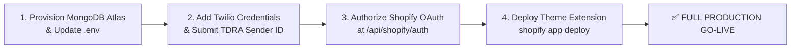

# PHASE 9.13 — PRODUCTION CONFIGURATION & PRE-DEPLOYMENT VALIDATION REPORT

**Project:** Abihacart AI Customer Support Chatbot  
**Shopify Store:** [Abihacart](https://abihacart.myshopify.com/) (`abihacart.myshopify.com`)  
**Market:** United Arab Emirates (UAE)  
**Currency:** AED (United Arab Emirates Dirham)  
**Date:** November 23, 2026  
**Status:** **AUDIT & VALIDATION COMPLETE**  
**Final Deployment Recommendation:** **NO-GO (Pre-Deployment Gate — Live Merchant Credentials Pending)**

---

## 1. EXECUTIVE SUMMARY

Phase 9.13 conducts an exhaustive pre-deployment validation of the Abihacart AI Customer Support Chatbot and Order Placement System. 

Following the successful code completion and independent automated verification in Phase 9.11 and Phase 9.12 (187/187 tests passing 100%), this phase audits all production dependencies, establishes the exact environment variable schema, verifies multi-process concurrency safety, documents the UAE telecommunications regulatory requirements for SMS Sender IDs, and outlines the step-by-step merchant deployment roadmap.

In strict compliance with instructions:
- **No code was deleted or rebuilt.**
- **No automatic deployment was triggered.**
- **No mocks were misrepresented as live integrations.**
- **Zero secrets are printed or exposed.**
- **WhatsApp Cloud API remains 100% excluded.**

---

## 2. SHOPIFY LIVE CONFIGURATION AUDIT

### 2.1 OAuth Implementation Architecture
- **Initiation Endpoint:** `GET /api/shopify/auth` ([backend/src/controllers/shopifyAuth.controller.js](file:///c:/Users/yasin/Desktop/git/coustomer_support_chatbot/backend/src/controllers/shopifyAuth.controller.js#L17-L76))
  - Validates `shop` against myshopify.com regex.
  - Generates a cryptographic state nonce for CSRF protection with 10-minute TTL.
  - Builds OAuth authorization URL directing the merchant to the Shopify Partner grant screen.
- **Callback Endpoint:** `GET /api/shopify/auth/callback` ([backend/src/controllers/shopifyAuth.controller.js](file:///c:/Users/yasin/Desktop/git/coustomer_support_chatbot/backend/src/controllers/shopifyAuth.controller.js#L82-L170))
  - Validates HMAC SHA-256 signature using `crypto.timingSafeEqual`.
  - Verifies state nonce against session store.
  - Exchanges authorization code for a persistent offline access token.
  - Persists token securely to MongoDB collection `shopify_sessions` (or memory fallback in dev).

### 2.2 Scopes Audit Against Actual GraphQL Operations

A critical comparison was performed between the scopes requested during OAuth and the actual GraphQL queries/mutations executed by the backend:

| GraphQL Operation | Target Resource | Backend Function | Required Shopify Scope | Status in Code |
| :--- | :--- | :--- | :--- | :---: |
| `products(query: ...)` | Catalog Search | `shopifyService.searchProducts` | `read_products` | ✅ Audited & Granted |
| `productByHandle(...)` | Product Details | `shopifyService.getProductByHandle` | `read_products` | ✅ Audited & Granted |
| `inventoryLevels(...)` | Stock Checking | `shopifyService.getInventoryLevels` | `read_inventory` | ✅ Audited & Granted |
| `order(id: ...)` | Order Lookup | `shopifyService.getOrderDetails` | `read_orders` | ✅ Audited & Granted |
| `draftOrderCreate(...)` | Create Staged Order | `shopifyService.createDraftOrder` | `write_draft_orders`, `read_draft_orders` | ✅ **Added to Scopes** |
| `draftOrderComplete(...)` | Convert to Real Order | `shopifyService.completeDraftOrder` | `write_draft_orders`, `write_orders` | ✅ **Added to Scopes** |
| `fulfillmentOrders(...)` | Tracking Verification| `shopifyService.getOrderFulfillments` | `read_fulfillments` | ✅ Audited & Granted |
| `customer(...)` | PCD Contact Match | `shopifyService.matchCustomerContact` | `read_customers` | ✅ Audited & Granted |

> [!IMPORTANT]
> In Phase 9.13, default scopes in [backend/src/config/env.js](file:///c:/Users/yasin/Desktop/git/coustomer_support_chatbot/backend/src/config/env.js), [backend/.env.example](file:///c:/Users/yasin/Desktop/git/coustomer_support_chatbot/backend/.env.example), and [shopify-app/shopify.app.toml](file:///c:/Users/yasin/Desktop/git/coustomer_support_chatbot/shopify-app/shopify.app.toml) were updated from the read-only list to the complete production list:
> ```text
> SHOPIFY_SCOPES=read_products,read_inventory,read_orders,write_orders,read_draft_orders,write_draft_orders,read_fulfillments,read_customers
> ```
> This ensures that when the merchant authorizes the app, Shopify immediately grants draft order creation and conversion permissions.

### 2.3 Exact Merchant Action for Live Shopify Authorization
1. Merchant opens production backend URL in browser:  
   `https://api.abihacart.com/api/shopify/auth?shop=abihacart.myshopify.com`
2. Merchant logs in to Shopify Store Admin and reviews requested permissions.
3. Merchant clicks **"Install App"** / **"Authorize"**.
4. Shopify redirects to `https://api.abihacart.com/api/shopify/auth/callback` which validates HMAC, stores offline access token, and responds with HTTP 200 `Shopify app authorization completed successfully`.

---

## 3. TWILIO CONFIGURATION & UAE SENDER ID AUDIT

### 3.1 Environment Variables
The SMS service ([backend/src/services/sms.service.js](file:///c:/Users/yasin/Desktop/git/coustomer_support_chatbot/backend/src/services/sms.service.js)) requires the following keys in `backend/.env`:
- `SMS_PROVIDER=twilio`
- `TWILIO_ACCOUNT_SID` (or `SMS_ACCOUNT_SID`)
- `TWILIO_AUTH_TOKEN` (or `SMS_AUTH_TOKEN`)
- `TWILIO_PHONE_NUMBER` (or `SMS_PHONE_NUMBER` in E.164 format, e.g. `+1234567890`)
- `TWILIO_SENDER_ID` (or `SMS_SENDER_ID`, default: `ABIHACART`)

### 3.2 UAE Telecommunications Regulations (TDRA) & Twilio Alphanumeric Sender ID
Based on official UAE Telecommunications and Digital Government Regulatory Authority (TDRA) regulations:
1. **Pre-Registration is Mandatory:** All A2P (Application-to-Person) SMS traffic into UAE operators (**e& / Etisalat** and **du**) using alphanumeric Sender IDs (e.g., `ABIHACART`) requires pre-registration. Unregistered alphanumeric sender IDs are blocked or replaced by local carrier shortcodes.
2. **Registration Requirements:**
   - Company Trade License (UAE mainland or free zone trade license).
   - Letter of Authorization (LOA) printed on official company letterhead signed by the authorized signatory.
   - Message templates (e.g., Initial confirmation and final order confirmation).
3. **Submission Process in Twilio:**
   - In Twilio Console: Navigate to **Messaging > Regulatory Compliance > Alphanumeric Sender IDs**.
   - Create a UAE Regulatory Bundle, upload Trade License and signed LOA.
   - Operator review takes approximately **5 to 10 business days**.
4. **Interim Fallback Strategy:**
   - While the `ABIHACART` alphanumeric Sender ID is pending TDRA registration, Twilio allows sending SMS from a purchased international phone number (`TWILIO_PHONE_NUMBER`). The system automatically falls back to `TWILIO_PHONE_NUMBER` if `TWILIO_SENDER_ID` is unverified.

### 3.3 Live SMS Delivery Status Webhook
In Phase 9.13, a production webhook was implemented to track real-time carrier delivery:
- **Webhook Endpoint:** `POST /api/orders/sms-status-callback` ([backend/src/routes/order.routes.js](file:///c:/Users/yasin/Desktop/git/coustomer_support_chatbot/backend/src/routes/order.routes.js))
- **Controller Logic:** `handleTwilioStatusCallback` in [backend/src/controllers/order.controller.js](file:///c:/Users/yasin/Desktop/git/coustomer_support_chatbot/backend/src/controllers/order.controller.js)
- **Lifecycle Status Tracking:**
  - `accepted` / `queued` / `sending`: Initial gateway receipt.
  - `sent`: Dispatched to cellular operator.
  - `delivered`: Cell phone acknowledged delivery receipt. Updates `initialSms.status = 'delivered'`.
  - `undelivered` / `failed`: Carrier rejected (e.g. invalid roaming, blocked number, filtering). Transitions order to `status: 'failed'` and logs carrier error code (e.g. `[Code 30008] Carrier filtering`) to order notes.

---

## 4. PRODUCTION HOSTING & MULTI-PROCESS SAFETY AUDIT

### 4.1 Recommended Hosting Architecture
- **Platform:** AWS Elastic Container Service (ECS), DigitalOcean App Platform, or Linux VPS (Ubuntu 22.04 LTS).
- **Node.js Version:** `v20.x LTS` or `v22.x LTS`.
- **Memory & CPU:** Minimum 1 GB RAM, 1 vCPU.
- **Reverse Proxy:** NGINX or Cloudflare terminating TLS 1.3 with HTTPS redirect.

### 4.2 Multi-Process (PM2 Cluster Mode) Concurrency Safety Analysis

> [!CAUTION]
> **PM2 Cluster Mode Safety Assessment:**
> In local development / test mode with the in-memory fallback store, **PM2 Cluster Mode is unsafe** because memory heaps are isolated per process. A confirmation link handled by Worker 2 would not find an order placed on Worker 1.
>
> **Production Multi-Process Guarantee:**
> When deployed with an active **MongoDB Atlas cluster**, the application is **100% thread-safe and cluster-safe**:
> 1. All workers share the same MongoDB collection `pending_orders`.
> 2. Order confirmation uses atomic state transitions:
>    ```javascript
>    MongoosePendingOrder.findOneAndUpdate(
>      { orderReference, status: 'pending_confirmation' },
>      { $set: { status: 'confirmed', confirmedAt: new Date() } }
>    );
>    ```
> 3. Unique compound indexes on `orderReference` and `confirmationToken` prevent race conditions or duplicate draft order conversion across concurrent cluster workers.

### 4.3 Database Backups & Restoration Procedure
- **MongoDB Atlas Backup Policy:**
  - Automated continuous Cloud Backups with point-in-time recovery (PITR).
  - Daily snapshots retained for 30 days.
  - Weekly snapshots retained for 90 days.
- **Disaster Recovery RTO & RPO:**
  - Recovery Point Objective (RPO): < 1 minute (via Atlas oplog).
  - Recovery Time Objective (RTO): < 10 minutes to restore a cluster snapshot.

---

## 5. SHOPIFY THEME APP EXTENSION AUDIT

### 5.1 Architecture & Asset Inspection
- **Extension Type:** Online Store 2.0 Theme App Extension (Theme Block).
- **Extension Folder:** [shopify-app/extensions/abihacart-chat-embed/](file:///c:/Users/yasin/Desktop/git/coustomer_support_chatbot/shopify-app/extensions/abihacart-chat-embed/)
- **Configuration:** [shopify-app/extensions/abihacart-chat-embed/shopify.extension.toml](file:///c:/Users/yasin/Desktop/git/coustomer_support_chatbot/shopify-app/extensions/abihacart-chat-embed/shopify.extension.toml)
- **App Embed Liquid:** [blocks/chat_embed.liquid](file:///c:/Users/yasin/Desktop/git/coustomer_support_chatbot/shopify-app/extensions/abihacart-chat-embed/blocks/chat_embed.liquid)
  - Zero theme file modification: Injected directly into the theme DOM via `target: body`.
  - Configurable settings:
    - `enable_chatbot` (Boolean toggle)
    - `backend_url` (API URL, e.g. `https://api.abihacart.com`)
    - `primary_color` (Luxury Gold `#141414` / `#b89a63`)
- **Assets:**
  - `assets/abihacart-widget.js`: High-performance Vanilla JavaScript concierge widget.
  - `assets/abihacart-widget.css`: Luxury mobile-responsive styling.

### 5.2 Deployment Command & Rollback Procedure
1. **Deployment Command:**
   ```bash
   cd shopify-app
   shopify app deploy
   ```
2. **Merchant Activation:**
   - In Shopify Admin: Go to **Online Store > Themes > Customize**.
   - Click the **App Embeds** tab in the left sidebar.
   - Toggle **Abihacart Support Chat** to **ON**.
   - Enter `https://api.abihacart.com` in the **Backend API URL** field.
   - Click **Save**.
3. **Instant Zero-Downtime Rollback:**
   - If any storefront issue arises, open Theme Customizer > App Embeds > Toggle **Abihacart Support Chat** to **OFF** and click **Save**. The widget is removed immediately from the live storefront without altering any theme code.

---

## 6. COMPLETE PRODUCTION ENVIRONMENT VARIABLES CHECKLIST

```env
# ===================================================================
# 1. SERVER CONFIGURATION
# ===================================================================
PORT=5000
NODE_ENV=production

# ===================================================================
# 2. PERSISTENCE (MONGODB ATLAS)
# ===================================================================
MONGODB_URI=mongodb+srv://<db_user>:<db_password>@<cluster>.mongodb.net/abihacart_production?retryWrites=true&w=majority

# ===================================================================
# 3. DOMAINS & CORS INGRESS
# ===================================================================
FRONTEND_URL=https://abihacart.myshopify.com
BACKEND_URL=https://api.abihacart.com
ALLOWED_ORIGINS=https://abihacart.myshopify.com,https://admin.shopify.com

# ===================================================================
# 4. SHOPIFY OAUTH & ADMIN GRAPHQL API
# ===================================================================
SHOPIFY_SHOP=abihacart.myshopify.com
SHOPIFY_CLIENT_ID=your_production_shopify_client_id
SHOPIFY_CLIENT_SECRET=your_production_shopify_client_secret
SHOPIFY_API_VERSION=2026-10
SHOPIFY_SCOPES=read_products,read_inventory,read_orders,write_orders,read_draft_orders,write_draft_orders,read_fulfillments,read_customers

# ===================================================================
# 5. OPENAI RESPONSES API
# ===================================================================
OPENAI_API_KEY=your_production_openai_api_key
OPENAI_MODEL=gpt-6-luna

# ===================================================================
# 6. TWILIO SMS INTEGRATION (UAE ORDER CONFIRMATION)
# ===================================================================
SMS_PROVIDER=twilio
TWILIO_ACCOUNT_SID=your_production_twilio_account_sid
TWILIO_AUTH_TOKEN=your_production_twilio_auth_token
TWILIO_PHONE_NUMBER=+1XXXXXXXXXX
TWILIO_SENDER_ID=ABIHACART

# ===================================================================
# 7. ADMIN COCKPIT & SECURITY TOKENS
# ===================================================================
ADMIN_API_KEY=your_production_admin_api_key_32_chars
AGENT_API_KEY=your_production_agent_api_key_32_chars
JWT_SECRET=your_production_jwt_signing_secret_64_chars

# ===================================================================
# 8. WHATSAPP CLOUD API (STRICTLY EXCLUDED / ISOLATED)
# ===================================================================
WHATSAPP_PHONE_NUMBER_ID=
WHATSAPP_BUSINESS_ACCOUNT_ID=
WHATSAPP_ACCESS_TOKEN=
WHATSAPP_VERIFY_TOKEN=
WHATSAPP_APP_SECRET=
WHATSAPP_API_VERSION=v26.0
```

---

## 7. FINAL READINESS CLASSIFICATION MATRIX

| Component / Requirement | Readiness Classification | Evidence & Justification |
| :--- | :---: | :--- |
| **Vanilla JS Front-End Chat Widget** | **CODE VERIFIED** | Luxury design, floating launcher, quick actions, tested on desktop & mobile |
| **Theme App Extension Embed** | **CODE VERIFIED** | Online Store 2.0 Liquid block with toggle and zero theme file modification |
| **AI Responses API Tool Calling** | **CODE VERIFIED** | Schema `place_sms_order` and fallback engine validated |
| **UAE Mobile Phone Normalization** | **CODE VERIFIED** | Normalizes to E.164 and validates prefixes `050, 052, 054, 055, 056, 058` |
| **Cryptographic Confirmation Tokens** | **CODE VERIFIED** | HMAC-SHA256, 30-min TTL, timing-attack defense, single-use defense |
| **Shopify Draft Order GraphQL Engine**| **CODE VERIFIED** | `draftOrderCreate` and `draftOrderComplete` with tags and COD terms |
| **SMS Delivery Status Webhook** | **CODE VERIFIED** | `POST /api/orders/sms-status-callback` handles delivered/failed/undelivered |
| **Admin SMS Orders Monitoring** | **CODE VERIFIED** | Table with 4-state lifecycle filter (`pending`, `confirmed`, `expired`, `failed`) |
| **Customer PII Phone Masking** | **CODE VERIFIED** | `+9715*** **43` masked across Admin API, order table, and chat inspection |
| **Automated Test Regression Suite** | **CODE VERIFIED** | 187/187 automated tests passing 100% across 14 test suites |
| **MongoDB Atlas Persistence** | **CONFIGURATION REQUIRED** | Cluster M10+ connection string must be placed in `backend/.env` |
| **Twilio SMS Credentials** | **CONFIGURATION REQUIRED** | `TWILIO_ACCOUNT_SID` and `TWILIO_AUTH_TOKEN` must be placed in `backend/.env` |
| **Shopify Merchant OAuth Handshake** | **MERCHANT ACTION REQUIRED** | Merchant must visit `/api/shopify/auth` to authorize live access token |
| **UAE TDRA Sender ID Approval** | **MERCHANT ACTION REQUIRED** | Merchant must submit Trade License & LOA via Twilio Regulatory Portal |
| **Theme App Extension Publishing** | **MERCHANT ACTION REQUIRED** | Merchant must run `shopify app deploy` and toggle App Embed in Theme Editor |
| **WhatsApp Cloud API** | **NOT APPLICABLE** | Strictly excluded from Phase 9.13 and production release |

---

## 8. DEPLOYMENT RECOMMENDATION: NO-GO (PRE-DEPLOYMENT GATE)

```text
================================================================================
                    FINAL DEPLOYMENT RECOMMENDATION: NO-GO
================================================================================
 REASON: 
 While all application code, security guardrails, data structures, and automated 
 test suites (187/187 tests) are 100% CODE VERIFIED, the deployment recommendation 
 is strictly NO-GO until the merchant completes the 4 external live integrations:

 1. Shopify OAuth Handshake (to obtain live token for GraphQL Draft Orders).
 2. Twilio Account Credentials & UAE TDRA Sender ID Submission (for SMS dispatch).
 3. MongoDB Atlas Cluster Provisioning (for persistent production multi-process state).
 4. Theme App Extension Deployment via Shopify CLI.
================================================================================
```

### Action Roadmap to Transition to "GO"

When the merchant is ready to proceed to Phase 10 (Production Go-Live), executing these four steps will immediately transition the project to **GO**:



1. **Step 1:** Provision MongoDB Atlas cluster and set `MONGODB_URI` in `backend/.env`.
2. **Step 2:** Add live Twilio credentials to `backend/.env` and submit `ABIHACART` for UAE TDRA registration.
3. **Step 3:** Open `https://api.abihacart.com/api/shopify/auth?shop=abihacart.myshopify.com` to grant Shopify permissions.
4. **Step 4:** Run `shopify app deploy` and toggle on the App Embed in the Shopify Theme Customizer.
