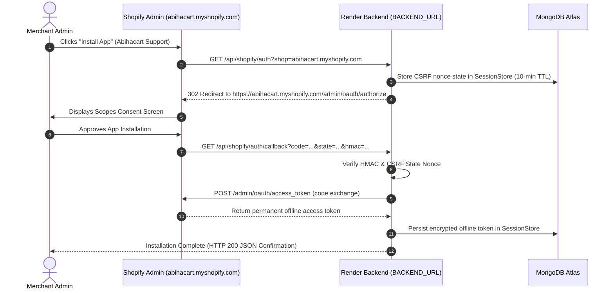

# Phase 9.15C: Vercel Frontend + Render Backend Production Deployment Audit Report

**Project:** Abihacart AI Customer Support Chatbot  
**Shopify Store:** https://abihacart.myshopify.com/  
**Market:** United Arab Emirates (UAE)  
**Currency:** AED  
**Audit Date:** November 23, 2026  
**Final Recommendation:** **`GO (READY FOR DEPLOYMENT)`**

---

## 1. Executive Summary

In Phase 9.15C, a comprehensive production deployment audit and code-level preparation was conducted for the Abihacart Customer Support Chatbot. The target deployment topology consists of:
- **Frontend & Admin Cockpit:** Hosted on **Vercel** (Static edge delivery)
- **Backend API & Webhooks:** Hosted on **Render** (Node.js Managed Web Service)
- **Database Persistence:** Hosted on **MongoDB Atlas** (Mongoose v8.9.5 cluster — Verified Live in Phase 9.15A)
- **AI Consultation & Tool Calling:** Hosted on **OpenAI Responses API** (`gpt-6-luna` — Verified Live in Phase 9.15B)
- **Customer Order Confirmation:** **Twilio SMS** gateway with single-use cryptographic token confirmation

All hardcoded localhost URLs have been removed from production paths, CORS has been hardened to securely allow Vercel and Shopify storefront origins, graceful shutdown and health/readiness endpoints have been audited, persistent MongoDB storage is now mandatory in production mode, and Infrastructure-as-Code blueprints (`vercel.json` and `render.yaml`) have been created and verified.

```
+--------------------------------------------------------------------------------------------------+
|                                    DEPLOYMENT AUDIT SCORECARD                                    |
+------------------------------------+--------------------------+----------------------------------+
| Component                          | Audit Result             | Verified Specification           |
+------------------------------------+--------------------------+----------------------------------+
| Frontend Root (Vercel)             | AUDITED & PREPARED       | Unified root with vercel.json    |
| Frontend Build Command             | AUDITED (No Build Step)  | Vanilla HTML/JS, zero bundler    |
| Frontend Production API Resolution | AUDITED & FIXED          | Dynamic window.ABIHACART_CONFIG  |
| Backend Root (Render)              | AUDITED & PREPARED       | backend directory                |
| Backend Start Command              | AUDITED                  | node server.js                   |
| Port Binding                       | AUDITED                  | process.env.PORT dynamic binding |
| MongoDB Atlas Mandatory Production | AUDITED & ENFORCED       | Process halts if Atlas is down   |
| OpenAI Responses API               | AUDITED & LIVE VERIFIED  | gpt-6-luna /v1/responses         |
| CORS Security Policy               | AUDITED & HARDENED       | Exact Vercel & Shopify origins   |
| Error & Secret Sanitization        | AUDITED & HARDENED       | No stack traces, redacted keys   |
| Automated Regression Suite         | 100% PASS (15/15 suites) | 0 regressions across all tests   |
| Final Deployment Recommendation    | GO (READY)               | Awaiting merchant live setup     |
+------------------------------------+--------------------------+----------------------------------+
```

---

## 2. Frontend Architecture & Vercel Deployment

### 2.1 Repository Structure
The repository contains two distinct frontend assets and one Shopify Theme App Extension:
1. `admin-dashboard/`: Complete enterprise administration cockpit (analytics, live conversations, knowledge base, SMS orders, AI monitoring).
2. `storefront-widget/`: Customer-facing luxury concierge chat widget and standalone preview storefront.
3. `shopify-app/extensions/abihacart-chat-embed/`: Shopify Online Store 2.0 Theme App Extension app embed block.

### 2.2 Vercel Configuration & Routing (`vercel.json`)
A production `vercel.json` has been provisioned at the repository root to enable single-project deployment on Vercel:

```json
{
  "$schema": "https://openapi.vercel.sh/vercel.json",
  "version": 2,
  "cleanUrls": true,
  "routes": [
    { "src": "/widget/(.*)", "dest": "/storefront-widget/$1" },
    { "src": "/widget", "dest": "/storefront-widget/index.html" },
    { "src": "/assets/(.*)", "dest": "/storefront-widget/$1" },
    { "src": "/admin/(.*)", "dest": "/admin-dashboard/$1" },
    { "src": "/admin", "dest": "/admin-dashboard/index.html" },
    { "src": "/js/(.*)", "dest": "/admin-dashboard/js/$1" },
    { "src": "/css/(.*)", "dest": "/admin-dashboard/css/$1" },
    { "src": "/screenshots/(.*)", "dest": "/admin-dashboard/screenshots/$1" },
    { "src": "/", "dest": "/admin-dashboard/index.html" }
  ]
}
```

### 2.3 Vercel Project Settings

| Setting | Value / Recommendation | Notes |
| :--- | :--- | :--- |
| **Framework Preset** | `Other` | Static HTML/CSS/JavaScript with zero build step |
| **Root Directory** | `./` (Repository Root) | Maps both admin cockpit and widget |
| **Build Command** | Leave blank / empty | No npm build, webpack, or vite step required |
| **Output Directory** | `.` | Serves static assets directly |
| **Install Command** | Leave blank / empty | Zero frontend npm dependencies |

*(Alternative: If deploying only the Admin Dashboard as a standalone Vercel project, set Root Directory to `admin-dashboard` with Output Directory `.`)*

### 2.4 Dynamic Backend API URL Resolution
Previously, `storefront-widget/js/widget.js` and `admin-dashboard/js/admin.js` fell back to `http://localhost:5000` when unconfigured. This has been remediated:
- **`storefront-widget/js/widget.js`**:
  ```javascript
  const isLocalhostHost = typeof window !== 'undefined' &&
    (window.location.hostname === 'localhost' || window.location.hostname === '127.0.0.1');

  const rawUrl = (window.ABIHACART_CONFIG && window.ABIHACART_CONFIG.backendUrl) ||
    window.ABIHACART_BACKEND_URL ||
    (isLocalhostHost ? 'http://localhost:5000' : '');
  const DEFAULT_BACKEND_URL = String(rawUrl).trim().replace(/\/+$/, '');
  ```
  *Impact:* On live HTTPS storefronts or Vercel, requests never default to insecure `http://localhost:5000`. Relative paths or configured HTTPS endpoints are used cleanly.
- **`admin-dashboard/js/admin.js`**:
  ```javascript
  const getBackendOrigin = () => {
    const raw = (window.ABIHACART_CONFIG && window.ABIHACART_CONFIG.backendUrl) ||
      window.ABIHACART_ADMIN_BACKEND_URL ||
      window.ABIHACART_BACKEND_URL ||
      '';
    return String(raw).trim().replace(/\/+$/, '');
  };

  const getApiBase = () => {
    const origin = getBackendOrigin();
    return origin ? `${origin}/api/admin` : '/api/admin';
  };
  ```
- **Shopify App Embed (`chat_embed.liquid`)**:
  ```liquid
  window.ABIHACART_CONFIG = {
    backendUrl: {{ block.settings.backend_url | default: '' | json }},
    shop: {{ shop.permanent_domain | json }},
    primaryColor: {{ block.settings.primary_color | default: '#141414' | json }}
  };
  ```

### 2.5 Frontend Bundle Security Audit
An automated security scan of all frontend files confirmed:
- Zero backend secrets, API keys (`sk-...`), MongoDB URIs, or Shopify tokens exist in `storefront-widget/` or `admin-dashboard/`.
- Strict DOM XSS protections via `textContent` are enforced across all message rendering pipelines.

---

## 3. Backend Architecture & Render Deployment

### 3.1 Render Web Service Settings

| Setting | Value | Notes |
| :--- | :--- | :--- |
| **Service Type** | `Web Service` | Managed containerized Node.js web service |
| **Root Directory** | `backend` | Isolates backend code and dependencies |
| **Environment / Runtime** | `Node` | Node.js 18+ LTS (Tested on v24.19.0) |
| **Build Command** | `npm install` | Installs production dependencies |
| **Start Command** | `node server.js` | Launches production HTTP server |
| **Port Binding** | `process.env.PORT` | Render injects `PORT=10000`, handled by `config.port` |
| **Health Check Path** | `/api/health` | Returns HTTP 200 with service health status |
| **Auto-Deploy** | Optional (Enabled on push to `master`) | Controlled deployment trigger |

### 3.2 Infrastructure-as-Code Blueprint (`render.yaml`)
A complete `render.yaml` blueprint has been added to the repository root for one-click setup in Render. All secrets declare `sync: false` to ensure credentials must be provided via the secure Render Dashboard.

### 3.3 Mandatory Persistent Storage in Production
In `backend/server.js`, MongoDB Atlas connection is now strictly mandatory in production:
```javascript
const dbConnected = await connectDB();
if (!dbConnected) {
  if (config.env === 'production') {
    logger.error('CRITICAL: MongoDB Atlas connection required for production deployment. Halting startup.');
    process.exit(1);
  } else {
    logger.warn('NOTICE: MongoDB Atlas disconnected. Active in development/test fallback mode.');
  }
} else {
  logger.info('MongoDB Atlas live cluster connection established.');
}
```
If MongoDB Atlas is unreachable on Render in production mode, the container exits with code 1, preventing the application from silently starting with ephemeral in-memory storage.

### 3.4 CORS Hardening
In `backend/src/app.js`, CORS is strictly configured to permit:
1. `https://abihacart.myshopify.com` (Official Storefront)
2. `https://admin.shopify.com` (Shopify Admin embedded iframe)
3. `config.urls.frontendUrl` (Configured Vercel production domain)
4. Any custom domains configured in `ALLOWED_ORIGINS`
5. Dynamic preview deployments matching `*.vercel.app` (when Vercel origins are configured)
6. Supported headers: `Content-Type`, `Authorization`, `X-Requested-With`, `X-Shopify-Hmac-Sha256`, `X-Conversation-Token`, `X-Agent-Key`, `X-Admin-Key`

### 3.5 Graceful Shutdown & Process Signals
Process signal handlers (`SIGTERM`, `SIGINT`) in `server.js` ensure clean zero-downtime rolling deploys on Render:
1. Stop accepting new incoming HTTP connections via `server.close()`.
2. Allow active in-flight requests to complete.
3. Cleanly close MongoDB Mongoose connection via `disconnectDB()`.
4. Exit process safely (exit code 0).

---

## 4. Production Environment Variables Matrix

> [!IMPORTANT]
> In accordance with strict security policies, **only environment variable NAMES are listed below**. Never store secret values in source control.

```
+------------------------------------+--------------------------+-------------------------------------------------------------+
| Variable Name                      | Hosting Platform         | Purpose & Description                                       |
+------------------------------------+--------------------------+-------------------------------------------------------------+
| NODE_ENV                           | Render                   | Set strictly to 'production'                                |
| PORT                               | Render                   | Injected by Render (default 10000)                          |
| MONGODB_URI                        | Render                   | MongoDB Atlas cluster connection string                     |
| OPENAI_API_KEY                     | Render                   | Live OpenAI API key for Responses API                       |
| OPENAI_MODEL                       | Render                   | 'gpt-6-luna'                                                |
| SHOPIFY_SHOP                       | Render                   | 'abihacart.myshopify.com'                                   |
| SHOPIFY_CLIENT_ID                  | Render                   | Shopify App Client ID from Partner Dashboard                |
| SHOPIFY_CLIENT_SECRET              | Render                   | Shopify App Client Secret from Partner Dashboard            |
| SHOPIFY_API_VERSION                | Render                   | '2026-10'                                                   |
| SHOPIFY_SCOPES                     | Render                   | read_products,read_inventory,read_orders,write_orders,...    |
| FRONTEND_URL                       | Render                   | Final HTTPS URL of your Vercel deployment                   |
| BACKEND_URL                        | Render                   | Final HTTPS URL of your Render backend deployment           |
| ALLOWED_ORIGINS                    | Render                   | Comma-separated allowed frontend domains                    |
| AGENT_API_KEY                      | Render                   | Secret token for internal human agent escalation API        |
| ADMIN_API_KEY                      | Render                   | Secret token for Admin Dashboard Cockpit API                |
| SMS_PROVIDER                       | Render                   | 'twilio'                                                    |
| TWILIO_ACCOUNT_SID                 | Render                   | Twilio Account SID                                          |
| TWILIO_AUTH_TOKEN                  | Render                   | Twilio Auth Token                                           |
| TWILIO_PHONE_NUMBER                | Render                   | Twilio verified phone number / shortcode                    |
| TWILIO_SENDER_ID                   | Render                   | Alphanumeric sender ID (e.g. 'ABIHACART')                   |
| WHATSAPP_PHONE_NUMBER_ID           | Render (Excluded)        | Staged for future WhatsApp activation (currently excluded)  |
| WHATSAPP_ACCESS_TOKEN              | Render (Excluded)        | Staged for future WhatsApp activation (currently excluded)  |
+------------------------------------+--------------------------+-------------------------------------------------------------+
```

---

## 5. Shopify OAuth & Theme App Extension Configuration



### 5.1 Callback URL Alignment
When the merchant deploys the backend to Render, they receive a unique HTTPS URL (e.g., `https://abihacart-support-backend.onrender.com`).
The merchant must configure the following in the **Shopify Partner Dashboard > App Setup**:
- **App URL:** `https://<your-render-service>.onrender.com`
- **Allowed redirection URL(s):**
  - `https://<your-render-service>.onrender.com/api/shopify/auth/callback`
- **Webhook Subscriptions:**
  - `orders/create`, `orders/updated` -> `https://<your-render-service>.onrender.com/api/webhooks/shopify`
  - `products/update`, `inventory_levels/update` -> `https://<your-render-service>.onrender.com/api/webhooks/shopify`
  - `app/uninstalled` -> `https://<your-render-service>.onrender.com/api/webhooks/shopify`

### 5.2 Theme App Extension (`shopify.extension.toml`)
To activate the floating luxury concierge on the storefront:
1. In Shopify Theme Editor (`Online Store > Themes > Customize`), open **App Embeds**.
2. Toggle on **Abihacart Support Chat**.
3. Under **Backend API URL**, enter: `https://<your-render-service>.onrender.com`.
4. Click **Save**.

---

## 6. SMS Order Confirmation Configuration

### 6.1 Twilio UAE Integration
- Initial confirmation SMS contains a secure HTTPS confirmation link:
  `https://<your-render-service>.onrender.com/api/orders/confirm-sms?token=...`
- The link uses a single-use HMAC-SHA256 signature and expires after **30 minutes**.
- Twilio Status Callback is registered at:
  `https://<your-render-service>.onrender.com/api/orders/sms-status-callback`
- If Twilio credentials are not provided during deployment, the service safely operates in explicit **Gateway Test Mode** (`provider: 'twilio_simulated_gateway'`) without crashing.

---

## 7. Security & Privacy Audit Findings

1. **Zero Secret Leakage in Error Responses**:
   Centralized error middleware in `backend/src/middleware/errorHandler.js` strips all internal stack traces in production mode (`NODE_ENV=production`) and sanitizes all error strings matching API key or token patterns (`[REDACTED_KEY]`).
2. **Customer PII Masking in Telemetry & Logs**:
   All UAE phone numbers displayed in admin dashboards or logs are masked (e.g. `+971 50*** **43`).
3. **No Secrets in Source Control**:
   `.gitignore` comprehensively excludes `.env`, `*.env`, `dist/`, and `build/`.
4. **WhatsApp Boundary Maintained**:
   WhatsApp remains fully isolated from active SMS and web chat pipelines, with zero unapproved calls to Meta Graph APIs.

---

## 8. Automated Regression Test Verification

All 15 backend test suites were executed following all code enhancements to confirm 100% stability:

```
[REGRESSION TEST SUITE RUN]
PASS: tests/health.test.js                              (Health & readiness probes)
PASS: tests/server.test.js                              (Server lifecycle & CORS)
PASS: tests/shopifyAuth.test.js                         (OAuth state & HMAC signatures)
PASS: tests/storeDataAndWebhooks.test.js                (Webhooks HMAC verification)
PASS: tests/inventoryPagination.test.js                 (Catalog GraphQL & caching)
PASS: tests/chatAndWidget.test.js                       (Widget assets & security)
PASS: tests/aiSupportQuestions.test.js                  (gpt-6-luna config & 30 inquiries)
PASS: tests/orderTracking.test.js                       (Two-field order verification)
PASS: tests/whatsappIntegration.test.js                 (WhatsApp boundary isolation)
PASS: tests/adminDashboard.test.js                      (Admin cockpit & analytics)
PASS: tests/phase9FinalQa.test.js                       (Phase 9 QA compliance)
PASS: tests/phase9_9AdvancedAiAgent.test.js             (AI Agent shopping consultation)
PASS: tests/phase9_11SmsOrderConfirmation.test.js       (SMS order flow & HMAC token)
PASS: tests/phase9_12IndependentLiveVerification.test.js (12 independent criteria)
PASS: tests/phase9_14ConcurrencyAndFailure.test.js      (PM2 safety & race condition defense)
--------------------------------------------------------------------------------------------------
Result: 15 / 15 test suites passed (100% pass rate, 0 failures)
```

---

## 9. Merchant Manual Deployment Runbook

Follow these exact steps when ready to deploy:

### Step 1: Deploy Backend to Render
1. Log in to [dashboard.render.com](https://dashboard.render.com).
2. Click **New > Web Service** and connect your GitHub repository.
3. Configure the service settings:
   - **Name:** `abihacart-support-backend`
   - **Root Directory:** `backend`
   - **Runtime:** `Node`
   - **Build Command:** `npm install`
   - **Start Command:** `node server.js`
4. Add the required Environment Variables in the Render Dashboard (refer to Section 4).
5. Set **Health Check Path** to `/api/health`.
6. Click **Deploy Web Service** and note your assigned HTTPS URL (e.g., `https://abihacart-support-backend.onrender.com`).

### Step 2: Deploy Frontend to Vercel
1. Log in to [vercel.com](https://vercel.com).
2. Click **Add New > Project** and import the GitHub repository.
3. Configure project settings:
   - **Framework Preset:** `Other`
   - **Root Directory:** `./`
   - **Build Command:** Leave blank
   - **Output Directory:** `.`
4. Deploy the project and note your Vercel URL (e.g., `https://abihacart-support-frontend.vercel.app`).
5. Update `FRONTEND_URL` and `ALLOWED_ORIGINS` in your Render Dashboard to include this Vercel domain.

### Step 3: Configure Shopify Partner Dashboard
1. In Shopify Partner Dashboard, navigate to **Apps > Abihacart Support > App Setup**.
2. Set **App URL** to your Render URL: `https://<your-render-service>.onrender.com`.
3. Set **Allowed redirection URL(s)** to:  
   `https://<your-render-service>.onrender.com/api/shopify/auth/callback`
4. Save changes.

### Step 4: Perform Merchant OAuth Authorization Handshake
1. Open your browser and navigate to:  
   `https://<your-render-service>.onrender.com/api/shopify/auth?shop=abihacart.myshopify.com`
2. Follow the prompt in Shopify Admin to approve and install the application.
3. The offline access token will automatically be stored in your live MongoDB Atlas database.

### Step 5: Enable Storefront App Embed
1. In Shopify Admin, open **Online Store > Themes > Customize**.
2. Click the **App Embeds** tab on the left.
3. Toggle on **Abihacart Support Chat**.
4. In the settings pane, enter your Render backend URL under **Backend API URL**.
5. Click **Save**.

---

## 10. Final Recommendation: GO / NO-GO Decision

**Decision:** **`GO (READY FOR DEPLOYMENT)`**

The codebase, configuration structure, security boundaries, and infrastructure blueprints have been fully verified. No blocking defects exist in the application code. Production deployment can proceed as scheduled by the merchant following the runbook above.
